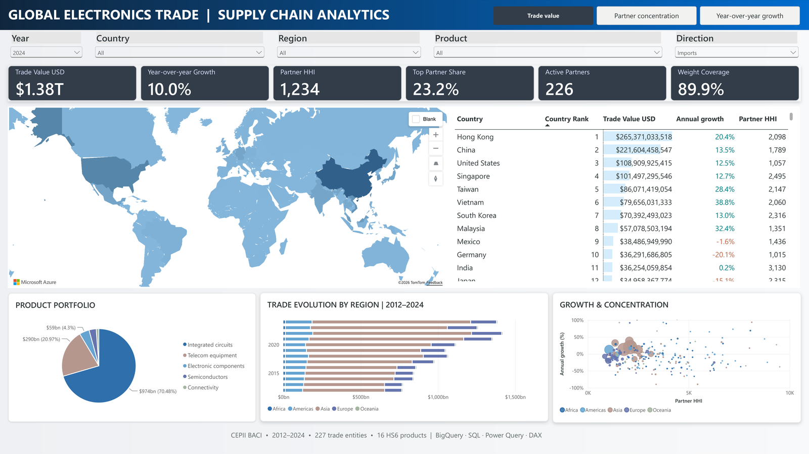

# Global Electronics Trade & Supply Chain Analytics | BigQuery, Power BI & SQL

An end-to-end personal analytics project by Victor Cabaleiro Valado, connecting **BigQuery, SQL, Power Query, DAX and Power BI** to explore global electronics and telecommunications trade.

[Open Power BI report (public interactive report)](https://app.powerbi.com/view?r=eyJrIjoiOTllMDUzMmYtYWIyZC00NDc0LTk0YTYtYzU5MmRlMDVlYWJlIiwidCI6Ijc5Yzc0MmM0LWU2MWMtNGZhNS1iZTg5LWEzY2I1NjZhODBkMSIsImMiOjN9)

## Business questions

- Where are electronics and telecom trade flows concentrated?
- How does partner dependence differ across economies and products?
- Which markets are growing, and how has regional trade evolved?

## Data and architecture

**CEPII BACI, HS12, release 202601:** 1,107,277 annual bilateral product flows across 2012–2024, 227 trade entities and 16 selected HS6 products in five categories.

BACI CSV → BigQuery Sandbox → SQL reporting views → Power Query → dimensional semantic model → DAX → Power BI.

The Google Cloud display name is Global Trade and Supply Chain (the platform limits project names to 30 characters). The stable project ID remains `victor-electronics-telecom21`; the dataset is `electronics_telecom`.

## Interactive report

One visible Global Network page integrates six KPI cards, a filled world map, dynamic country ranking, product portfolio, regional trade evolution and a growth/concentration scatter plot. Three bookmark buttons switch trade value, partner concentration and year-over-year growth while preserving year, country, region, product and import/export filters. Hidden Country Profile and Country Tooltip pages provide drill-through and contextual detail.

Measures include current-USD trade value, comparable annual growth, partner HHI, top-partner share, active partners and weight coverage. HHI is the sum of squared partner shares multiplied by 10,000. The trend uses the full 2012–2024 history while retaining the other analytical filters.

Growth uses a labelled −100% to +100% view to avoid extreme observations compressing most points; full growth values remain in the country table. Source economies such as Hong Kong, Macao and Taiwan remain distinct customs territories; China is labelled China.

## Reproducibility

- `scripts/extract_baci.py`: source extraction.
- `sql/`: raw checks, reporting views and country trade roles.
- `data/reference/`: country and product dimensions.
- `powerbi/`: DAX, Power Query, model and design source material.
- `docs/`: validation evidence. Older screenshots/checks describe earlier iterations.

The native report is authored in Power BI Service. Local model/design files are supporting source material, not a complete PBIX/PBIR export or a guarantee of a one-click deployment.

## Sources and interpretation

[CEPII BACI documentation](https://www.cepii.fr/DATA_DOWNLOAD/baci/doc/baci_webpage.html) · [HS12 source archive](https://www.cepii.fr/DATA_DOWNLOAD/baci/data/BACI_HS12_V202601.zip) · [UN M49 geography](https://unstats.un.org/unsd/methodology/m49/)

BACI source values are thousands of current USD and metric tons; reporting values convert USD by multiplying by 1,000. Imports and exports are alternative perspectives, not additive global totals. Missing weight is not zero. Nominal trade growth is not inflation-adjusted growth. HHI describes concentration, not the probability of disruption. These country-level annual trade data do not provide company revenue, inventory, shipment delays, OTIF or real-time logistics. No predictive AI model is claimed.

The native report is published to the public web and opens without signing in. The cover is a real screenshot with Trade value selected.
